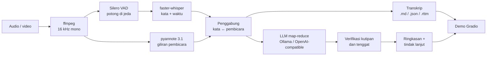

# Notulen ID

Pipeline notulen otomatis untuk rapat dan podcast berbahasa Indonesia. Masukannya rekaman audio, keluarannya transkrip per pembicara, ringkasan, dan daftar tindak lanjut yang bisa dilacak ke kutipan aslinya.

<!-- Ganti dengan rekaman demo: simpan GIF di docs/demo.gif lalu hapus komentar ini. -->
<!--  -->

> **Demo:** _(tautan Hugging Face Space menyusul)_

## Masalah yang diselesaikan

Menulis notulen rapat itu lambat, dan hasilnya sering tidak lengkap: siapa berjanji mengerjakan apa, dan kapan tenggatnya, mudah terlewat. Alat transkripsi yang ada umumnya berbahasa Inggris, tidak membedakan pembicara, atau meringkas tanpa bisa dicek kebenarannya.

Proyek ini menjawab tiga kebutuhan:

1. **Siapa bicara apa.** Transkrip dipisah per pembicara dengan penanda waktu.
2. **Apa hasilnya.** Ringkasan berisi topik, keputusan, dan poin penting.
3. **Siapa mengerjakan apa.** Setiap tindak lanjut punya penanggung jawab, tenggat, dan **kutipan sumber yang wajib ada di transkrip**. Item yang kutipannya tidak ditemukan dibuang, sehingga LLM tidak bisa mengarang tugas.

Setiap tahap diukur dengan metrik standar (WER, DER, ROUGE-L, BERTScore, F1 tindak lanjut), dan kesalahannya dibedah di [notebook analisis](notebooks/01_error_analysis.ipynb).

## Arsitektur



| Tahap | Modul | Keterangan |
| --- | --- | --- |
| Pra-proses | [audio/preprocess.py](src/notulen/audio/preprocess.py) | ffmpeg ke WAV 16 kHz, VAD Silero, audio panjang dipotong di jeda agar tidak memotong kata. |
| ASR | [asr/transcriber.py](src/notulen/asr/transcriber.py) | faster-whisper (CTranslate2) dengan timestamp per kata, fallback ke CPU jika CUDA gagal. |
| Diarization | [diarization/diarizer.py](src/notulen/diarization/diarizer.py) | `pyannote/speaker-diarization-3.1`, jumlah pembicara otomatis atau ditentukan. |
| Penggabungan | [merge/aligner.py](src/notulen/merge/aligner.py) | Tiap kata diberi pembicara dengan tumpang tindih waktu terbesar (atau giliran terdekat), lalu digabung jadi ucapan. |
| Ringkasan | [summarize/](src/notulen/summarize/) | Map-reduce per jendela teks, dedup tindak lanjut, verifikasi kutipan (fuzzy) dan tenggat. |
| Demo | [app/gradio_app.py](app/gradio_app.py) | Progres per tahap, unduh hasil, siap untuk ZeroGPU di Hugging Face Spaces. |

Semua pengaturan ada di [configs/default.yaml](configs/default.yaml). Rahasia (token, API key) hanya dibaca dari `.env`.

## Hasil evaluasi

Diukur dengan `scripts/evaluate.py` di NVIDIA GeForce RTX 4050 Laptop GPU. Model: faster-whisper `medium` (int8_float16), pyannote 3.1, dan LLM `gemma3:4b` lewat Ollama. Detail lengkap di [reports/results.md](reports/results.md).

| Tahap | Data uji | Metrik | Hasil |
| --- | --- | --- | ---: |
| ASR | FLEURS id, 100 ucapan (21 menit) | WER / CER | **10.6%** / 3.8% |
| ASR | sama | Real-time factor | 0.20 |
| Diarization | 6 rapat simulasi (LibriVox), jumlah pembicara otomatis | DER | **13.4%** |
| Diarization | sama, jumlah pembicara diberikan | DER | 7.6% |
| Ringkasan | 4 naskah rapat dan podcast, ringkasan referensi manual | ROUGE-L / BERTScore F1 | 0.477 / 0.777 |
| Tindak lanjut | sama, 9 item referensi | Precision / Recall / F1 | 58.3% / 77.8% / **66.7%** |
| Tindak lanjut | item yang cocok | Penanggung jawab benar | 85.7% |

Perbandingan ukuran model ([reports/latency.md](reports/latency.md), 30 ucapan FLEURS):

| Model | RTF | WER | VRAM puncak |
| --- | ---: | ---: | ---: |
| small | 0.114 | 15.2% | 514 MB |
| medium | 0.206 | 11.6% | 1128 MB |

`medium` dipilih sebagai default: WER-nya 3.6 poin lebih baik, dan tetap sekitar 5 kali lebih cepat dari waktu nyata.

## Analisis kesalahan

Ringkasan dari [notebooks/01_error_analysis.ipynb](notebooks/01_error_analysis.ipynb):

- **ASR: nama diri asing dan ejaan.** 30% ucapan bebas kesalahan. Sekitar 58% kesalahan kata berupa bunyi atau ejaan yang mirip ("pesisir" lawan "pisisir", "Uppsala" lawan "opsala"). Sekitar 15% hanya beda format angka ("17" lawan "tujuh belas") atau spasi ("ibukota" lawan "ibu kota"). Tanpa keduanya, WER turun ke sekitar 9.0%.
- **Keyakinan Whisper bisa dipercaya sebagai sinyal.** Korelasi Spearman antara keyakinan kata dan WER adalah -0.67. Median WER 20% ucapan dengan keyakinan terendah 21.8%, sisanya 5.3%.
- **VAD bisa membuang ucapan pelan.** Satu dari 100 ucapan hilang seluruhnya karena probabilitas VAD tidak pernah mencapai ambang 0.5.
- **Diarization: salah tebak jumlah pembicara adalah sumber utama.** Dua rapat dengan jumlah pembicara salah tebak menyumbang 94% detik salah-pembicara. Jika jumlahnya diberikan, DER turun dari 13.4% ke 7.6%.
- **Tindak lanjut: metrik terlalu keras, LLM kadang terlalu rajin.** Audit manual menemukan 2 dari 5 prediksi "salah" sebenarnya benar, hanya beda kata ("Buat" lawan "Membuat"). Dengan koreksi itu precision menjadi 75% dan recall 100%. Kesalahan nyata: usulan yang ditunda dianggap tugas, dan saran podcast untuk pendengar dianggap tugas. Satu penanggung jawab tertukar: LLM memilih pemberi perintah, bukan orang yang dipanggil.

## Keterbatasan

- **Data uji kecil dan dibacakan.** FLEURS dan LibriVox berisi teks yang dibaca, bukan percakapan spontan dengan jeda ragu, bahasa gaul, dan campur kode. Rapat sungguhan kemungkinan memberi WER lebih tinggi.
- **Tidak ada ucapan tumpang tindih** di rapat simulasi, sehingga DER di sini lebih optimistis daripada rapat sungguhan.
- **Ringkasan dinilai pada 4 dokumen** dengan referensi yang ditulis satu orang. Angkanya indikatif, bukan pembanding antar-model.
- **LLM lokal kecil.** `gemma3:4b` dipilih agar muat di GPU laptop. Model yang lebih besar kemungkinan lebih baik membedakan usulan dari keputusan.
- **Angka tidak dinormalisasi** saat menghitung WER, jadi "17" lawan "tujuh belas" dihitung salah.
- **Versi pustaka dikunci.** pyannote.audio 3.x butuh `huggingface_hub<1`. Secara lokal, torch dikunci di 2.5.1. Di Spaces dipakai torch 2.8 dengan pemuatan checkpoint yang dibatasi pada pipeline resmi pyannote.
- **Privasi.** Dengan Ollama semuanya berjalan lokal. Dengan backend OpenAI-compatible (termasuk demo Spaces), transkrip dikirim ke penyedia LLM.

## Menjalankan

### Prasyarat

- Anaconda atau Miniconda
- [Ollama](https://ollama.com) untuk LLM lokal, lalu `ollama pull gemma3:4b`
- GPU NVIDIA (opsional). Tanpa GPU semuanya tetap jalan di CPU, hanya lebih lambat.
- Token Hugging Face (izin read) untuk pyannote:
  1. Buat token di <https://huggingface.co/settings/tokens>.
  2. Setujui syarat penggunaan di [pyannote/speaker-diarization-3.1](https://huggingface.co/pyannote/speaker-diarization-3.1) dan [pyannote/segmentation-3.0](https://huggingface.co/pyannote/segmentation-3.0).

### Windows (PowerShell)

```powershell
git clone <url-repo> notulen-id
cd notulen-id
conda env create -f environment.yml
conda activate notulen

# GPU NVIDIA: torch dengan CUDA 12.1, plus cuBLAS dan cuDNN untuk faster-whisper
pip install torch==2.5.1 torchaudio==2.5.1 --index-url https://download.pytorch.org/whl/cu121
pip install -e ".[dev,gpu]"
# Tanpa GPU: cukup  pip install -e ".[dev]"

Copy-Item .env.example .env    # lalu isi HF_TOKEN
python scripts/check_device.py
```

### Linux (bash)

```bash
git clone <url-repo> notulen-id
cd notulen-id
conda env create -f environment.yml
conda activate notulen

# Wheel torch default di PyPI untuk Linux sudah membawa CUDA
pip install torch==2.5.1 torchaudio==2.5.1
pip install -e ".[dev,gpu]"     # tanpa GPU: pip install -e ".[dev]"

cp .env.example .env            # lalu isi HF_TOKEN
python scripts/check_device.py
```

Jika faster-whisper tidak menemukan `libcublas` atau `libcudnn` di Linux, tambahkan pustaka pip NVIDIA ke `LD_LIBRARY_PATH`, sesuai [petunjuk faster-whisper](https://github.com/SYSTRAN/faster-whisper#gpu):

```bash
export LD_LIBRARY_PATH=$(python -c 'import os, nvidia.cublas.lib, nvidia.cudnn.lib; print(os.path.dirname(nvidia.cublas.lib.__file__) + ":" + os.path.dirname(nvidia.cudnn.lib.__file__))')
```

Langkah Linux di atas belum diuji di mesin Linux. Pengembangan dilakukan di Windows 11.

### Pemakaian

Perintah di bawah sama untuk PowerShell dan bash.

```powershell
# Satu file: transkrip, diarization, ringkasan
python scripts/run_pipeline.py rapat.mp3 --num-speakers 3
# Hasil di outputs/rapat/: transcript.md, transcript.json, diarization.rttm,
# summary.md, summary.json, timings.json

# Tanpa LLM, atau tanpa diarization
python scripts/run_pipeline.py rapat.mp3 --no-summary
python scripts/run_pipeline.py rapat.mp3 --no-diarization

# Demo web di http://127.0.0.1:7860
python app/gradio_app.py
```

Ganti konfigurasi lewat `--config path.yaml` atau variabel lingkungan `NOTULEN_CONFIG`. File config bisa mewarisi config lain dengan `extends: default.yaml` dan hanya menulis bagian yang berbeda, seperti [configs/spaces.yaml](configs/spaces.yaml).

Untuk memakai LLM yang kompatibel dengan OpenAI (OpenAI, Groq, Hugging Face router, dan lain-lain), ubah `llm.backend` menjadi `openai_compatible`, isi `llm.model` dan `llm.openai_compatible.base_url`, lalu simpan key di `.env` sebagai `LLM_API_KEY`.

### Evaluasi dan pengujian

```powershell
python scripts/build_test_set.py        # unduh FLEURS dan LibriVox, buat data/test_set/
python scripts/evaluate.py              # tulis reports/results.md
python scripts/benchmark_latency.py     # tulis reports/latency.md
python -m pytest -q                     # unit test
ruff check .
```

Notebook analisis membaca `outputs/eval/` dari `evaluate.py`. Untuk menjalankannya ulang:

```powershell
python -m ipykernel install --user --name notulen
jupyter nbconvert --to notebook --execute --inplace --ExecutePreprocessor.kernel_name=notulen notebooks/01_error_analysis.ipynb
```

## Deploy ke Hugging Face Spaces (ZeroGPU)

Space memakai [configs/spaces.yaml](configs/spaces.yaml): Whisper dan pyannote di GPU yang dipinjam per permintaan, LLM lewat Hugging Face router, dan batas audio 2 menit agar muat di kuota GPU harian pengunjung.

1. Buat Space baru dengan SDK **Gradio** dan hardware **ZeroGPU**.
2. Di Settings, Secrets, tambahkan `HF_TOKEN`. Token ini butuh izin baca model pyannote dan izin **Make calls to Inference Providers**.
3. Siapkan folder Space dan unggah:

   ```powershell
   python scripts/prepare_space.py      # menulis dist/space
   hf auth login
   hf upload <username-hf>/<nama-space> dist/space . --repo-type space
   ```

Ringkasan di Space memakai kredit Inference Providers milik pemilik token. Jika kredit habis, demo tetap menampilkan transkrip dan memberi tahu bahwa ringkasan gagal.

## Struktur proyek

```text
app/                 demo Gradio
configs/             default.yaml, spaces.yaml
data/test_set/       audio, transkrip, RTTM, dan ringkasan referensi
deploy/spaces/       README untuk halaman Space
notebooks/           analisis kesalahan
reports/             hasil evaluasi dan latensi
scripts/             CLI: pipeline, evaluasi, benchmark, data uji, Spaces
src/notulen/         paket utama (audio, asr, diarization, merge, summarize, evaluation)
tests/               unit test
app.py               entry point untuk Hugging Face Spaces
```

## Lisensi

MIT. File `LICENSE` belum ditambahkan.
